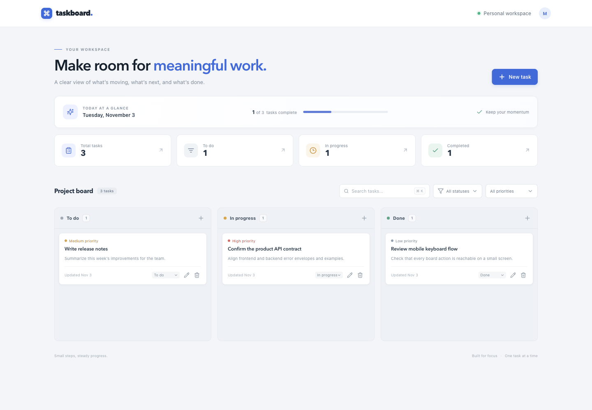
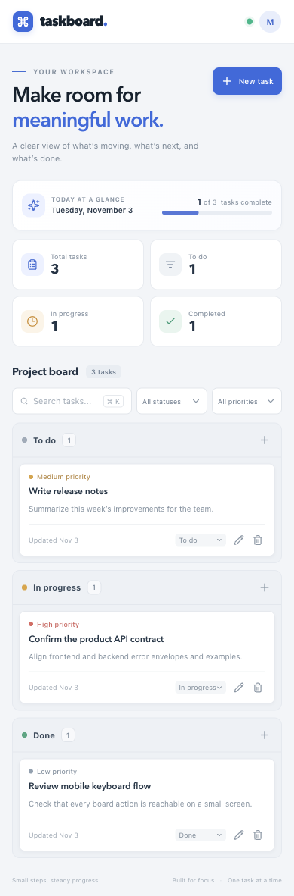
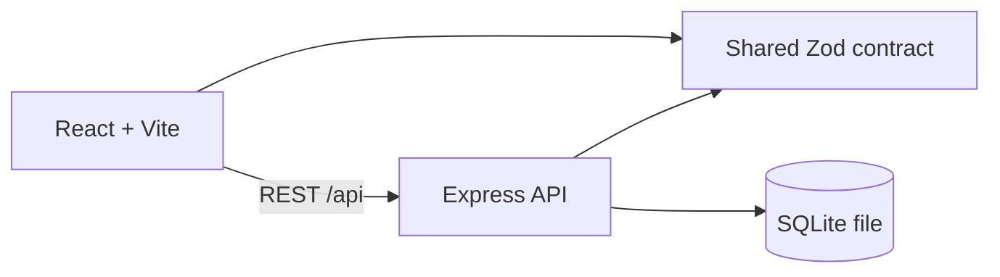
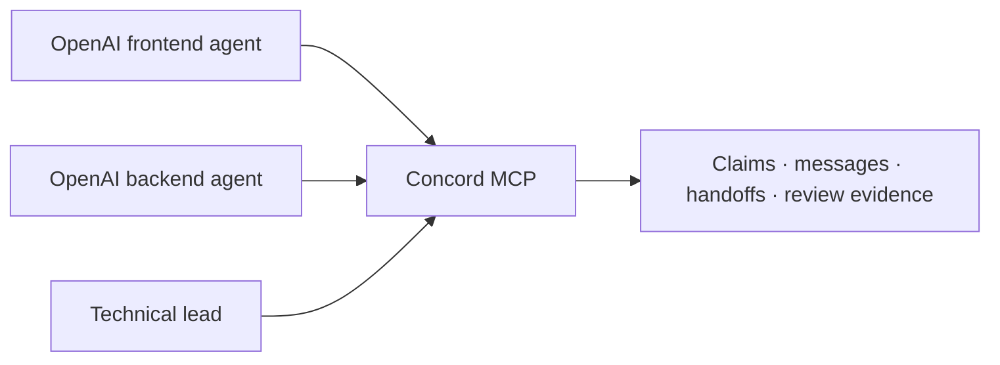

# AI Task Board

A local-first Kanban board built as a full-stack TypeScript portfolio project. It pairs a responsive React interface with a REST API and persistent SQLite storage.

## Why this project exists

This project evaluates how OpenAI coding agents can collaborate on a shared full-stack application, with Concord MCP as the coordination layer for presence, work ownership, messages, context, file claims and handoffs. Concord is a development-time coordination service; it is not an autonomous agent orchestrator and is not required by the running app. The current build's setup and experiment outcomes are reported plainly in [the Concord experiment](docs/CONCORD_EXPERIMENT.md).

## Features

- Create, edit and confirm deletion of tasks.
- Three Kanban statuses and three priorities, with drag and drop plus accessible status selectors.
- Search task titles and descriptions; combine status and priority filters.
- Database-backed total, to-do, in-progress and completed statistics.
- Loading, empty, API error and mutation feedback states.
- Responsive desktop/mobile layout and keyboard shortcut `⌘K` / `Ctrl+K` for search.
- SQLite persistence across API restarts.

## Screenshots

Desktop:



Mobile:



These are real screenshots from the running application. They show three sample tasks created through the UI against a temporary database; no seed tasks ship with the app.

## Tech stack

- React 19, TypeScript, Vite, authored CSS, TanStack Query, React Hook Form, Zod, Lucide React.
- Express 5, Node.js 22, Node's built-in SQLite module (`node:sqlite`).
- npm workspaces, Vitest 4, React Testing Library, Supertest, ESLint 9, Prettier, GitHub Actions.

The brief proposed Tailwind CSS and Prisma. This MVP uses a small authored CSS system and Node's built-in SQLite API instead: the UI needs no CSS compiler, and the built-in driver avoids native package install scripts. Node currently marks `node:sqlite` experimental; the app logs that warning during startup.

## Architecture

Runtime:



Development-time coordination:



The second diagram shows the intended collaboration model. In this run, two Codex subagents were used for isolated implementation, but Concord presence and lifecycle operations were not completed. See [Agent collaboration](docs/AGENT_COLLABORATION.md) and the experiment report for the verified state.

More detail: [architecture](docs/ARCHITECTURE.md), [API](docs/API.md), and [testing](docs/TESTING.md).

## Getting started

### Prerequisites

- Node.js 22 or newer (the project was verified with 22.20.0).
- npm 10 or newer.

### Install and run

```bash
npm ci
cp .env.example .env
npm run dev
```

Open [http://127.0.0.1:5173](http://127.0.0.1:5173). The API listens on [http://127.0.0.1:4000](http://127.0.0.1:4000). Set `API_PORT`, `API_HOST`, `DATABASE_PATH`, or `CORS_ORIGIN` in `.env` to customize local development. By default, the SQLite database is `apps/api/data/tasks.sqlite`.

Run services separately with `npm run dev:api` and `npm run dev:web`.

### Quality checks

```bash
npm run lint
npm run typecheck
npm test
npm run build
```

See [Testing](docs/TESTING.md) for test coverage and the verified results for this build.

## Concord MCP integration

The official Concord MCP package was installed and repository setup completed. The Codex adapter was detected as installed, but the active session did not reload the MCP config or trust the generated hooks. No agents appeared in the Concord roster and no Concord claims/messages/handoffs were recorded. The limitations and exact experiment outcomes are in [docs/CONCORD_EXPERIMENT.md](docs/CONCORD_EXPERIMENT.md).

## Security and limitations

- This local MVP has no authentication. Do not expose its unauthenticated write API publicly.
- The API binds to `127.0.0.1` by default, uses configured CORS origins and limits JSON bodies to 64 KB.
- The API uses `node:sqlite`, which is experimental in the verified Node version.
- No deployment, hosted database, authentication, or user accounts are included.
- Concord's shared coordination workflow is configured but its multi-session experiment remains incomplete.

## Future improvements

- Complete the two-session Concord experiment after reloading the Codex client and trusting its hooks.
- Add an authenticated deployment mode before exposing any API beyond loopback.
- Add accessibility checks and browser-driven regression coverage to CI.
- Consider replacing `node:sqlite` when Node marks the module stable.

## Author

Mohamed Nazim Gueye<br>
GitHub: [mng017](https://github.com/mng017)
