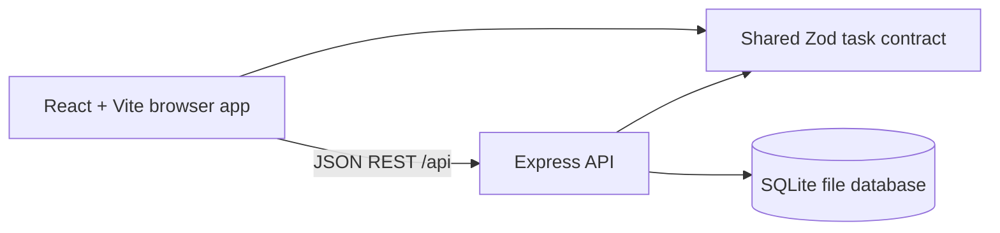
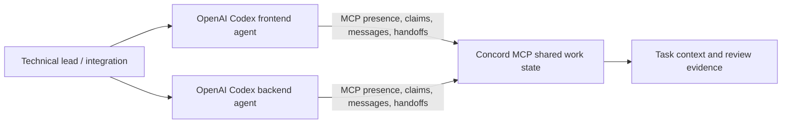

# Architecture

## Runtime

The browser talks to the API through `/api`. Vite proxies that path to the API in development. In production, deploy the web assets and API behind one local origin or configure a same-origin reverse proxy. The API binds to `127.0.0.1` by default, limits JSON bodies to 64 KB, and allows only configured CORS origins.

`packages/shared` owns task status/priority enums, create/update/task schemas, and the Task/TaskStats types used by both applications. The API stores rows in SQLite and returns UTC ISO timestamps. SQLite data lives under `apps/api/data` by default and is ignored by Git.

## Development-time collaboration

The intended workflow uses Concord for ownership, coordination and evidence. The checked-in experiment report distinguishes setup and adapter readiness from operations actually called by the agent sessions. No project runtime request depends on Concord or an OpenAI API.

## Security boundaries

- This is a local, single-user MVP without authentication. Keep the API on loopback and do not expose its unauthenticated write endpoints publicly.
- SQL uses prepared statements and allowlisted status/priority values.
- Request body and text input lengths are bounded; unexpected errors return a generic response.
- Tests use `:memory:` or a temporary SQLite file and never use the default development database.
